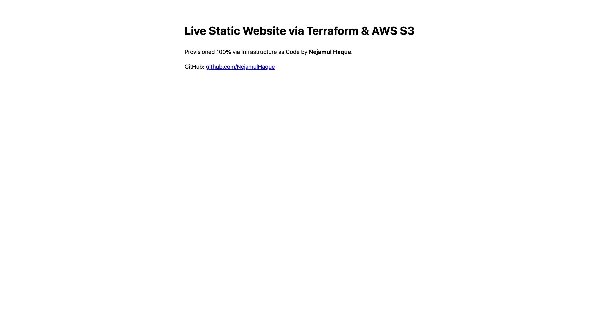

# Zero-Spend AWS Infrastructure as Code (`terraform-aws-infra`)

[](https://github.com/NejamulHaque/terraform-aws-infra/actions/workflows/terraform-sec.yml)


A production-grade **Terraform Infrastructure as Code (IaC)** repository engineered with a **DevSecOps** security-first workflow. It provisions a static **Amazon S3** web hosting environment alongside an isolated **AWS VPC, Public Subnet, Internet Gateway, Least-Privilege Security Group, and IMDSv2-hardened EC2 compute node** in `ap-south-1` (Mumbai), gated by automated **Trivy** static misconfiguration scanning in GitHub Actions with **$0.00 ongoing AWS spend**.

---

## Architecture Overview

```text
                        ┌──────────────────────────────────────────┐
                        │           GitHub Actions CI/CD           │
                        │  terraform fmt ─► validate ─► Trivy IaC  │
                        └────────────────────┬─────────────────────┘
                                             │
                                      [Passes 0 Issues]
                                             │
                                             ▼
┌─────────────────────────────────────────────────────────────────────────────────────┐
│                             AWS Cloud (ap-south-1)                                  │
│                                                                                     │
│  ┌───────────────────────────────────────┐   ┌───────────────────────────────────┐  │
│  │        Amazon S3 Static Hosting       │   │     Custom VPC (10.0.0.0/16)      │  │
│  │  • SSE-S3 (AES256) Encryption         │   │  ┌─────────────────────────────┐  │  │
│  │  • Object Versioning Enabled          │   │  │  Public Subnet 10.0.1.0/24  │  │  │
│  │  • Least-Privilege s3:GetObject       │   │  │  ┌───────────────────────┐  │  │  │
│  │  • force_destroy = true ($0 Teardown) │   │  │  │ EC2 t2.micro (AL2023) │  │  │  │
│  └───────────────────────────────────────┘   │  │  │ • IMDSv2 Enforced     │  │  │  │
│                                              │  │  │ • Encrypted gp3 EBS   │  │  │  │
│                                              │  │  │ • HTTP 80 Only SG     │  │  │  │
│                                              │  │  └───────────────────────┘  │  │  │
│                                              │  └──────────────┬──────────────┘  │  │
│                                              │                 ▼                 │  │
│                                              │         Internet Gateway          │  │
│                                              └───────────────────────────────────┘  │
└─────────────────────────────────────────────────────────────────────────────────────┘
```

---

## DevSecOps Security Controls

```text
+--------------------+----------------------+-------------------------------------------------------------------+
| Layer              | File                 | Provisioned Resources & Security Hardening                        |
+--------------------+----------------------+-------------------------------------------------------------------+
| Static Web Hosting | main.tf              | • S3 bucket with random_id suffix & force_destroy = true          |
|                    |                      | • SSE-S3 (AES256) encryption at rest ($0 Free Tier)               |
|                    |                      | • S3 Object Versioning enabled (AWS-0090 compliant)               |
|                    |                      | • Least-privilege s3:GetObject public read bucket policy          |
+--------------------+----------------------+-------------------------------------------------------------------+
| Network Isolation  | network_compute.tf   | • Custom VPC (10.0.0.0/16) with DNS hostnames & support enabled   |
|                    |                      | • Public Subnet (10.0.1.0/24), Internet Gateway & Route Table     |
|                    |                      | • Strict Security Group: HTTP 80 ingress & HTTPS 443 egress only  |
+--------------------+----------------------+-------------------------------------------------------------------+
| Compute Hardening  | network_compute.tf   | • Dynamic lookup for latest Amazon Linux 2023 x86_64 AMI          |
|                    |                      | • Mandatory IMDSv2 (http_tokens = "required") against SSRF        |
|                    |                      | • Encrypted 8 GB gp3 root EBS volume                              |
+--------------------+----------------------+-------------------------------------------------------------------+
| Policy-as-Code CI  | terraform-sec.yml    | • Enforces terraform fmt -check & terraform validate on push/PR   |
|                    |                      | • Runs Trivy config scan (blocks MEDIUM, HIGH & CRITICAL flaws)   |
|                    |                      | • Explicit #trivy:ignore justifications for Free Tier exceptions   |
+--------------------+----------------------+-------------------------------------------------------------------+
```

---

## Live Deployment Proof



---

## Repository Structure

```text
terraform-aws-infra/
├── .github/
│   └── workflows/
│       └── terraform-sec.yml    # Automated Terraform format, validate & Trivy IaC CI pipeline
├── assets/
│   └── live-s3-preview.png      # Verification screenshot of live AWS S3 website deployment
├── site/
│   └── index.html               # Static frontend payload uploaded to Amazon S3
├── .gitignore                   # Excludes .terraform/, *.tfstate, and local .env files
├── main.tf                      # S3 static website hosting, AES256 encryption & versioning
├── network_compute.tf           # Custom VPC, Subnet, IGW, Security Group & IMDSv2 EC2 node
└── README.md                    # Project architecture, security controls & lifecycle guide
```

---

## Quick Start & Zero-Billing Lifecycle

```bash
# 1. Clone the repository
git clone https://github.com/NejamulHaque/terraform-aws-infra.git
cd terraform-aws-infra

# 2. Authenticate locally via ~/.aws/credentials
aws configure

# 3. Initialize Terraform providers
terraform init

# 4. Enforce formatting, validate syntax, and run local Trivy security scan
terraform fmt -check
terraform validate
trivy config --skip-version-check .

# 5. Preview the execution plan
terraform plan

# 6. Provision infrastructure on AWS
terraform apply -auto-approve

# 7. Tear down all resources immediately after verification ($0.00 AWS spend)
terraform destroy -auto-approve
```

---

## CI/CD Pipeline Execution Flow

```text
git push / PR to main
  ├── 1. terraform fmt -check          -> Enforces canonical HCL formatting
  ├── 2. terraform init -backend=false -> Initializes provider schemas without AWS keys
  ├── 3. terraform validate            -> Verifies resource graph syntax & attribute types
  └── 4. aquasecurity/trivy-action     -> Fails build (exit-code: 1) on MEDIUM/HIGH/CRITICAL flaws
```

---

## Author

- **Name:** Nejamul Haque (B.Tech CSE '27 — DevSecOps, Cloud Infrastructure & Backend Engineering)
- **Portfolio:** [https://nejamulhaque.vercel.app](https://nejamulhaque.vercel.app)
- **GitHub:** [https://github.com/NejamulHaque](https://github.com/NejamulHaque)
- **LinkedIn:** [https://linkedin.com/in/nejamulhaque](https://linkedin.com/in/nejamulhaque)
